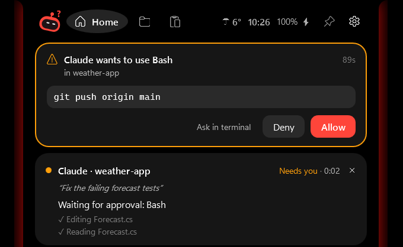
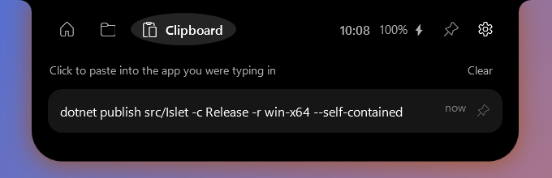

<p align="center"></p>

# Islet — a Dynamic Island for Windows

A living island at the top of your screen: music with synced lyrics, live progress from your builds and
training runs, your AI coding agents (with Allow / Deny right on the island), which app is using your mic
or camera, a file shelf and clipboard history. Hover it to expand; it peeks on its own when something happens.

**Free and open source (MIT). No accounts, no ads, no tracking.**

<p align="center">
  <br>
  
</p>

## Download

1. Go to **[Releases](https://github.com/KrishViradiya/islet/releases/latest)** and download `Islet-win-Setup.exe`
   (or `Islet-win-Portable.zip` if you'd rather not install).
2. Run it. Islet installs for your user only (no admin needed) and starts right away.
3. Windows may say **"Windows protected your PC"** because the app isn't code-signed yet (signing certificates cost money).
   Click **More info → Run anyway**. The source code is all here if you want to check it or build it yourself.

Islet updates itself from GitHub Releases. Requires Windows 10 (2004+) or Windows 11, 64-bit.
Uninstall from **Settings → Apps** like any other app; it removes its autostart entry and any Claude Code hooks it added.

| | |
|---|---|
|  |  |

## What makes it different

| Feature | What it does | Why it's new on Windows |
|---|---|---|
| **Live Activities API** | Any script or program can push live status to the island over `localhost:47823`. | iPhone has Live Activities for apps; no Windows island lets *your own code* drive it. |
| **`islet run <cmd>`** | Wraps any terminal command: shows it running, parses `NN%` from its output as a progress bar, turns green/red with the exit code when done. | Lets you leave long builds, `pip install`, or ffmpeg jobs and get notified at a glance. |
| **Python client** | `with Activity("Training"):` shows epochs and loss on the island while your model trains. | Built for ML workflows; no dependencies. |
| **Privacy Sentinel** | Names the exact app using your **microphone** (orange), **camera** (green) or **location** (blue) and alerts when one starts. | Windows only shows an anonymous tray glyph. |
| **Shelf** | Drop files on the island to park them; drag them back out into any app later. Persists across restarts. | Common on macOS (notch shelves), rare on Windows. |
| **Music + Spotify** | Album art, click-to-seek, shuffle / repeat (Spotify), a player switcher when several apps play, system volume slider, scroll-on-island volume HUD. No Spotify login needed. | Works with every player through Windows media controls. |
| **Synced lyrics** | Karaoke-style current and next line from [LRCLIB](https://lrclib.net) (free, no key), with title cleanup for YouTube-style video names. | |
| **Album-colour theming** | The accent, seek bar, card tint, equalizer and a soft glow take the colour of the playing artwork. | |
| **Clipboard history** | Text and images; click to paste straight into the app you were typing in (the island never steals focus); pin favourites. Password-manager content is ignored; only pins are saved. | |
| **Customization** | Settings window: notch or floating style, theme (system/dark/light), accent, size 80–200 %, folded/open opacity, animation feel, liquid edge, monitor, hover delay, Ctrl+Alt+I hotkey, every module on/off. Changes apply live. | |
| **Spring physics** | Size and shape are driven by damped springs, not fixed-time tweens, so interrupted transitions keep their momentum. The folded island stretches toward your cursor. | |
| **Liquid island** | The lower edge is a simulated elastic membrane (30 spring-joined points). It bulges toward your cursor, ripples to your speakers' *real* loudness (Core Audio peak meter) with long waves on the left and short on the right, drops a bead when something succeeds, jolts on errors, and sags when you're away. A rim in the album colour traces the edge while music plays. | Physics instead of canned animations, so every interaction blends with the last. |
| **Blip** | A tiny robot drawn from shapes. Eyes follow the cursor; he vibes to music, squints while agents work, tilts with a "?" when they need you, hops on success, snores when you're away, and gets dizzy if you poke him 4× or shake the cursor over the island. | Reacts to *your* tools (agents, builds, music), not just a timer. |
| **AI agents (Claude Code / Codex)** | Live status in the pill ("Claude · Editing Forecast.cs"), recent steps, the latest answer, a sound + bead when done, and **Allow / Deny right on the island** when Claude asks for permission. Free, local, one-click hook install with backup. | Uses Claude Code's `PermissionRequest` hook; no answer → the terminal asks as usual, your deny rules still win. |
| **Weather** (opt-in) | Temperature in the folded pill; the island *drips* when rain is due within the hour. Open-Meteo, no key. | Weather drives the liquid. |
| Fullscreen-aware | Hides itself during games and fullscreen video. | |

Inspiration: [exuupery/island](https://github.com/exuupery/island) (notch shape, tabs, ferrofluid ideas, characters) and
[TwoCode](https://twocode.nl/) (agent status and approvals in an island, a mascot with moods). Islet's implementations are its own.

## AI agents setup

1. Settings → **Agents** → **Install hooks** (adds `curl.exe` hooks to `~/.claude/settings.json`; a backup is written first). Press **Try a demo** to see the flow without Claude.
2. Start a new Claude Code session. The pill shows what Claude is doing; when it asks for permission the island opens with **Allow / Deny / Ask in terminal**.
3. If Islet isn't running, curl fails fast and Claude Code carries on (it shows a non-blocking hook error).
4. Codex CLI (experimental): **Copy config line** and paste it into `~/.codex/config.toml`.

## Tech stack (and why)

- **C# / .NET 10 (LTS) + WPF**: real transparent, always-on-top, click-through windows with GPU-composited
  animations. Calls Windows APIs (media sessions, registry, Win32) directly with no bridge layer.
  Electron or Tauri would need native add-ons for most of the features above.
- **WinRT** (`Windows.Media.Control`) for now-playing, via the `net10.0-windows10.0.19041.0` target.
- **HttpListener** for the Live Activities API, **System.Text.Json** for JSON.
- **Velopack** (MIT) for the installer and self-updates — the only NuGet package.

## Architecture

```
                 ┌──────────────────────────── Islet.exe ───────────────────────────────┐
 Spotify/Chrome ─┼─► MediaModule ──┬─► LyricsModule ◄── lrclib.net                     │
 (WinRT SMTC)    │                 │                                                    │
 Core Audio     ─┼─► AudioVolume ──┤                                                    │
 Registry       ─┼─► PrivacyModule ┤                                                    │
 Clipboard msgs ─┼─► ClipboardModule├─► IslandViewModel ──(bindings)──► IslandWindow    │
 Claude / Codex ─┼─► /agent/* ─► AgentHub (approvals wait for your click)              │
 Open-Meteo     ─┼─► WeatherModule                       LiquidEngine → edge, rim, beads│
 curl / islet   ─┼─► LiveActivity ─► ActivityHub      (state + events)  springs → shape │
 run / python    │    Server (HTTP)│        ▲                           tabs, peeks     │
 Drag & drop    ─┼─► ShelfModule ──┘        │                                           │
                 │              IslandSettings (settings.json) ◄── SettingsWindow       │
                 │              ThemeManager (dark/light, album accent)    TrayIcon     │
                 └──────────────────────────────────────────────────────────────────────┘
```

- **Modules** (`src/Islet/Modules`) each own one data source and write into the view model on the UI thread.
- **IslandViewModel** (`src/Islet/Core`) holds all state and raises `PeekRequested` when something
  noteworthy happens (new track, activity finished, mic turned on).
- **IslandWindow** is a large transparent window; only the black `Island` border is opaque, so clicks
  elsewhere pass through to the apps below. It animates between four modes:
  - **Compact**: a small pill. Shows the running activity, or album art + equalizer, plus privacy dots.
  - **Peek**: a 3-second one-line alert.
  - **Expanded** (on hover): clock, battery, privacy chips, media card, activities, shelf.
  - **Drop**: expanded with the shelf highlighted while you drag files over it.
- Collapse is driven by polling the real cursor position (5×/s), which is more reliable than `MouseLeave`
  for a non-activating window.

```
src/Islet/
  Program.cs               entry point (Velopack install/update hooks, then WPF)
  App.xaml(.cs)            startup, single instance, update checks, shared styles
  IslandWindow.xaml(.cs)   the island: springs, liquid edge, tabs, hover / drag-drop
  MascotView.xaml(.cs)     Blip
  SettingsWindow.xaml(.cs) customization
  TrayIcon.cs              tray menu (Settings, updates, Quit)
  Core/                    view model, settings, theme, springs, liquid engine, updater
  Modules/                 Media, Lyrics, Privacy, Clipboard, Shelf, Weather, Activities, Agents + HTTP server
  Interop/                 Win32 + Core Audio
tools/
  islet.ps1 / islet.cmd    CLI
  islet.py                 Python client
  islet-codex-notify.ps1   Codex bridge
assets/                    icon (generated by make-icon.ps1)
.github/workflows/         free CI build + release
```

## Build from source

Requires Windows 10 2004+ / Windows 11 and the [.NET 10 SDK](https://dotnet.microsoft.com/download) (free).

```bash
dotnet run --project src/Islet
```

Settings: double-click the tray icon or press the gear on the island. Logs and data live in `%APPDATA%\Islet`.

## Releasing (maintainers)

Releases are built by GitHub Actions for free — no paid services and no secrets beyond the built-in token.

```bash
git tag v0.3.1
```

```bash
git push origin v0.3.1
```

The [Release workflow](.github/workflows/release.yml) builds a self-contained app, packs `Islet-win-Setup.exe`
with Velopack, and publishes it to GitHub Releases. Installed copies update themselves.

## License, privacy, credits

- [MIT License](LICENSE) — use it, change it, share it.
- [Privacy](PRIVACY.md) — what stays on your PC and the three optional network features.
- [Third-party notices](THIRD-PARTY-NOTICES.md) — .NET and Velopack (MIT), Open-Meteo data (CC BY 4.0), LRCLIB.
  Spotify, Claude and other names are trademarks of their owners; Islet isn't affiliated with them.

## Live Activities API

| Method | Path | Body / effect |
|---|---|---|
| `GET` | `/` | health check |
| `GET` | `/activities` | list |
| `POST` | `/activities` | create or update: `{"id"?, "title", "subtitle"?, "progress"?: 0..1 or null, "state"?: "running" \| "success" \| "error"}` returns `{"id"}` |
| `POST` | `/activities/{id}` | update fields of an existing activity |
| `DELETE` | `/activities/{id}` | dismiss |

`progress: null` means indeterminate (elapsed time is shown instead). Finished activities linger for 8 s.

```bash
curl -X POST localhost:47823/activities -H "Content-Type: application/json" -d "{\"id\":\"render\",\"title\":\"Rendering\",\"progress\":0.3}"
```

### CLI

Add `tools/` to your PATH, then:

```bash
islet run npm run build
```

```bash
islet run pip install torch
```

`islet push "title" [subtitle] [progress]`, `islet set <id> <progress>`, `islet done <id>`, `islet fail <id>`, `islet ls`.

### Python

```python
from islet import Activity   # copy tools/islet.py next to your script

with Activity("Training ResNet-18") as act:
    for epoch in range(epochs):
        loss = train_one_epoch()
        act.update(progress=(epoch + 1) / epochs, subtitle=f"epoch {epoch+1} · loss {loss:.4f}")
```

If Islet isn't running, the client silently does nothing.

### Security

The API listens on `localhost` only. Requests with a browser `Origin` header are rejected (403), so
websites you visit can't post to your island. Any local program can, which is the point; there's no auth.

## Known limitations

- Not code-signed yet, so Windows SmartScreen warns on first run (see Download). Free signing for open-source
  projects is available through [SignPath Foundation](https://signpath.org/) — an application is planned.
- Memory is ~150–190 MB (WPF + WinForms + WinRT loaded). Trimming WinForms out is on the roadmap.
- Privacy Sentinel reads Windows' consent store, so it sees apps that go through Windows privacy
  permissions (almost all). It drops entries whose desktop process is no longer running.
- Media works with apps that integrate with Windows media controls (most do; some games don't).

## Roadmap ideas

1. **Notification mirroring**: show toasts in the island (needs app packaging/MSIX for `UserNotificationListener`).
2. **Meeting mode**: next calendar event with a countdown and "join" button.
3. **Focus timer**: Pomodoro as a built-in Live Activity.
4. **Plugins**: run user scripts on a schedule and turn their output into activities (CI status, server health).
5. **winget**: `winget install Islet` once releases are stable.
